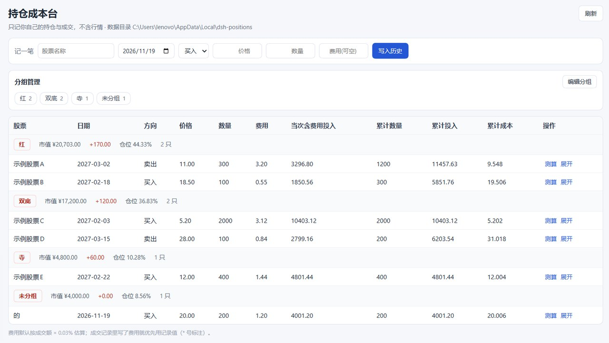
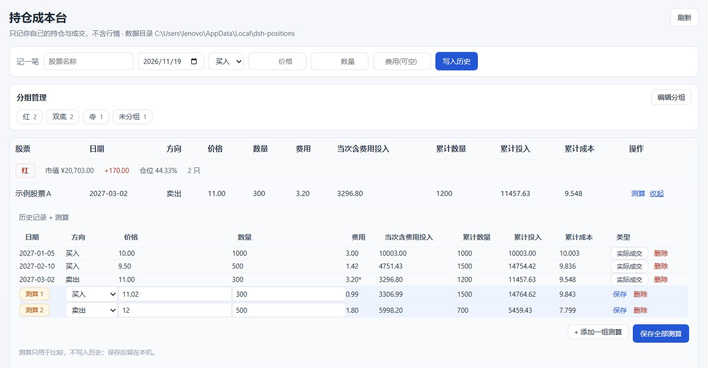
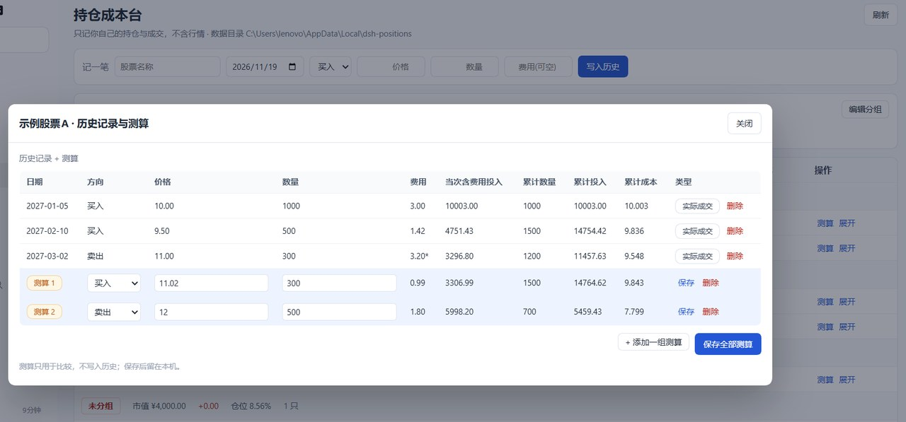
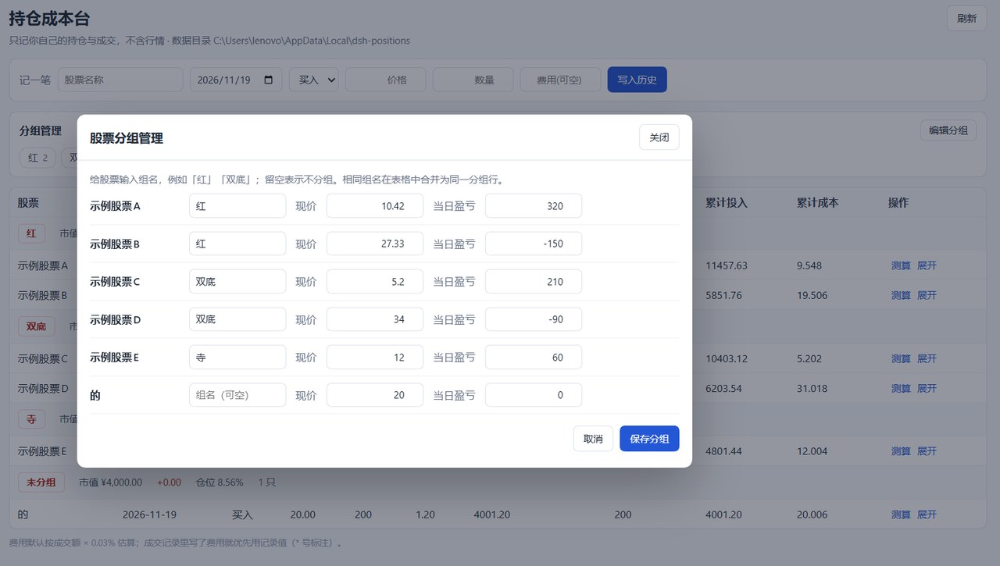

# 持仓成本台 · DSH 插件

在 DeepSeek Harness 里记持仓、记成交，**买入/卖出之前先算清楚成本会变成多少**。

大多数看盘软件告诉你「现在多少钱」，但不告诉你「买完这 200 股之后，我的成本、仓位、保本价会变成多少」。
这个插件只做这一件事，顺便把持仓和成交流水记下来。

> 不含行情、不联网、不荐股。所有数字都来自你自己录入的成交记录。

## 截图









## 安装

```sh
dsh plugin --profile web add @zhangxij/dsh-positions
```

装完重启 DSH，左侧栏会多一个「持仓」入口。

本地开发时（未发布 npm）：

```sh
dsh plugin --profile web add file:D:\path\to\dsh-positions
```

具体参数以 `dsh plugin --help` 为准。

## 怎么用

1. **记一笔**：顶部一行填股票、日期、买卖、价格、数量（费用可留空，会按费率估算），点「写入历史」。
2. **理论评价**：勾选维度后，表格右侧会多出对应列（当前显示「待规则」，规则留到后续版本）。
3. **分组**：展开某只股票，在详情里改「分组」，表格会按分组聚合出汇总行。
4. **测算**：展开股票 → 测算区填方向/价格/数量 → 立刻看到费用、累计数量、新成本；可以加多组一起比较，点「保存测算」会记住。
5. **现价/当日盈亏**：展开后填，用于计算市值与仓位占比。这是你自己填的数字，不是行情。

## 数据在哪

优先级从高到低：

1. `cordis.patch.yml` 里的 `config.dataDir`
2. 环境变量 `DSH_POSITIONS_DATA`
3. 仓库内 `data/`（仅开发目录存在时使用）
4. `%LOCALAPPDATA%\dsh-positions`（Windows）/ `~/.local/share/dsh-positions`（其他系统）

文件只有一个：`state.json`，每次修改立即落盘。**不会写进 `node_modules`。**

首次启动会写入 5 只示例股票，保证装完不是空白页；示例可以直接删。

## 隐私与权限

- 不发起任何外部网络请求（没有行情、没有统计、没有遥测）。
- 只读写上面那个数据目录里的 `state.json`。
- 服务端路由挂在 DSH 自身 HTTP 服务下（`/positions/*`），会校验同源，跨站请求直接 403。
- 卸载插件不会删数据目录，需要清空请手动删。

## 已知限制

- 没有行情，所以「市值 / 当日盈亏」要你自己填现价与盈亏。
- 理论评价目前只有标签位，规则判定要到后续版本。
- 单机单用户，没有账号体系（数据在你自己电脑上）。
- 无导出功能（后续加 JSON/CSV 导出）。

## 开发

```
index.js         服务端：数据目录、读写、/positions 路由
client.js        浏览器端：左侧栏入口 + 单页面板
seed.js          首次启动的示例数据
cordis.patch.yml 插件挂载与默认配置
test/            服务端测试
```

跑测试：

```sh
node test/server.test.mjs
```

测试会用一个临时目录，不会碰你的真实数据。

## 免责声明

本插件只做记账与成本推算，不提供行情、不构成投资建议。市场有风险，决策请自负。
